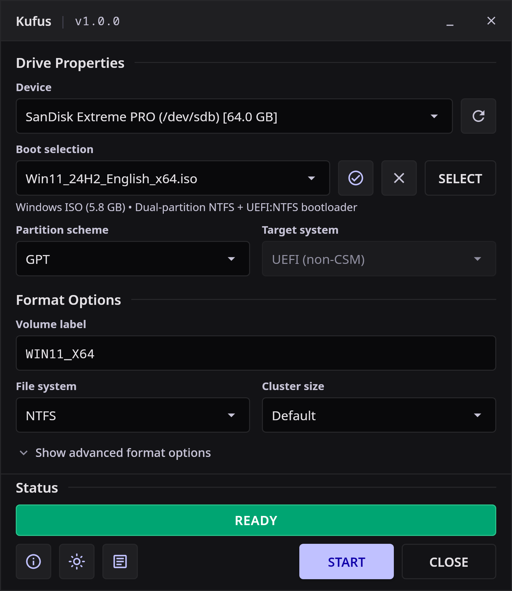
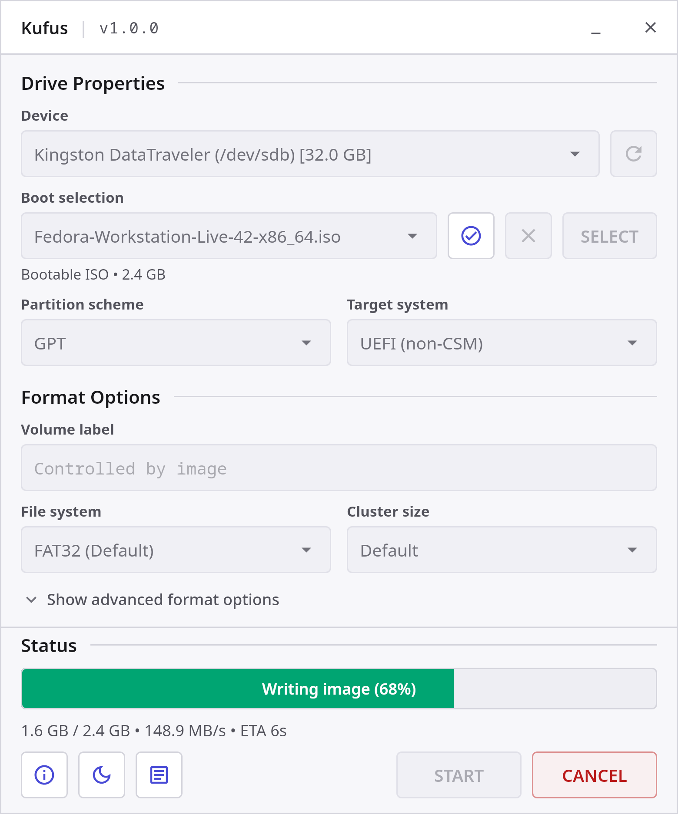
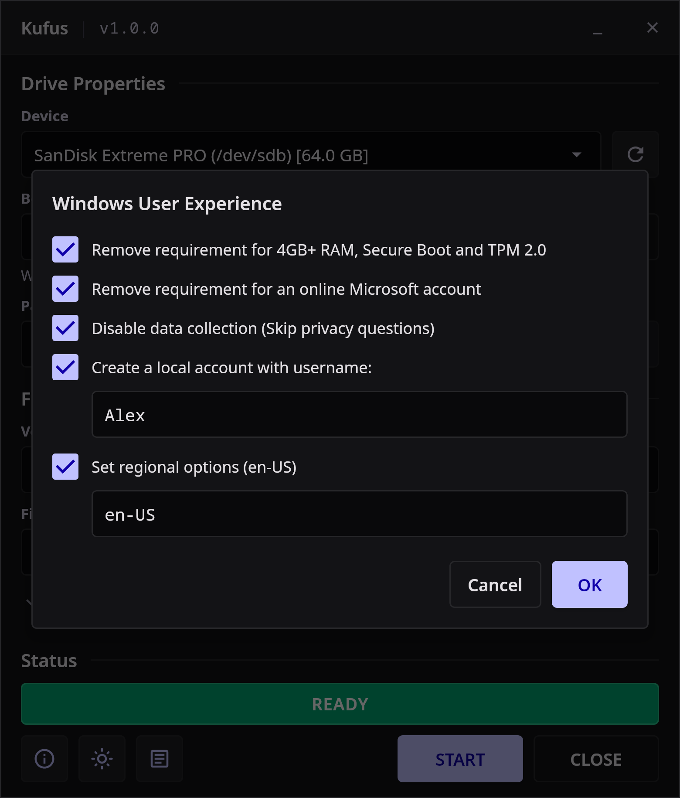
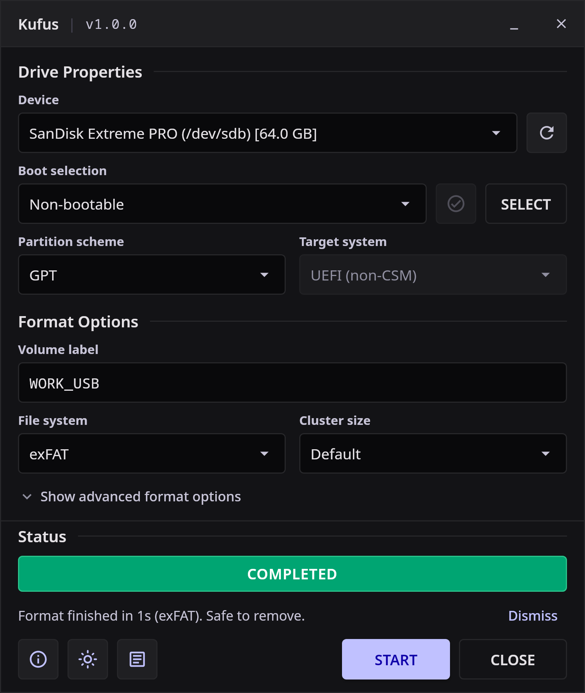
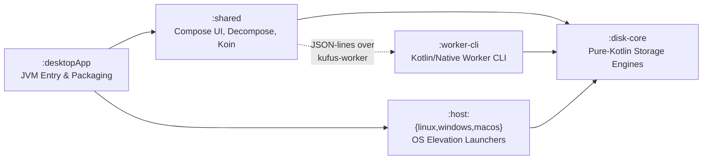

<div align="center">


# Kufus

**Cross-platform bootable USB creator, Windows ISO preparer, and raw disk formatter built with Kotlin Multiplatform & Compose Desktop.**

[](https://github.com/drlacheheb/Kufus/actions/workflows/ci.yml)
[](https://kotlinlang.org/)
[](https://www.jetbrains.com/compose-multiplatform/)
[](#platform-support)
[](LICENSE)

</div>

---

**Kufus** (*Kotlin USB Formatting Utility Suite*) brings a fast, Rufus-inspired desktop utility to **Linux**, **Windows**, and **macOS**. Its desktop UI runs unprivileged on the JVM, while a native Kotlin/Native worker handles raw block I/O, partition tables, pure-Kotlin filesystem formatting, on-the-fly decompression, and Windows installation media preparation.

## Screenshots

<div align="center">
<table>
  <tr>
    <td align="center" width="50%">
      <br />
      <sub><b>Dark Mode</b> — Windows 11 ISO ready (NTFS + UEFI:NTFS)</sub>
    </td>
    <td align="center" width="50%">
      <br />
      <sub><b>Light Mode</b> — Active ISO flashing with live speed &amp; ETA</sub>
    </td>
  </tr>
  <tr>
    <td align="center" width="50%">
      <br />
      <sub><b>Windows User Experience</b> — Automated <code>autounattend.xml</code> options</sub>
    </td>
    <td align="center" width="50%">
      <br />
      <sub><b>Drive Formatter</b> — Pure-Kotlin GPT/MBR &amp; FAT32/exFAT/NTFS/ext4</sub>
    </td>
  </tr>
</table>
</div>

## Features

- **Bootable Image Flashing**
  - Writes hybrid ISOs and raw disk images (`.iso`, `.img`, `.bin`) directly to USB flash drives.
  - Streams compressed images (`.gz`, `.xz` with LZMA2/BCJ, `.zst`) on the fly without unpacking temporary files to disk.
  - Optional post-write **SHA-256 verification** and automatic safe ejection.
- **Pure-Kotlin Filesystem Formatting & Partitioning**
  - Builds **GPT** and **MBR** partition tables directly in Kotlin with zero external formatter dependencies (`mkfs.*`, `newfs_exfat`, or `fmifs.dll` are not required).
  - Formats **Large FAT32** (> 32 GiB), **exFAT**, **NTFS**, and **ext4** with configurable cluster size, volume label sanitization, and quick or full zero-wipe modes.
- **Windows ISO Installer Preparation**
  - Pure-Kotlin ISO-9660 / UDF reader inspects Windows ISOs directly.
  - Supports **NTFS + UEFI:NTFS** dual-partition bootable drives (using the bundled `uefi-ntfs.img`) and **FAT32 UEFI** with a built-in pure-Kotlin **WIM splitter** (`install.wim` → `install.swm`) when images exceed 4 GiB.
  - Optional **Windows User Experience** customization (`\autounattend.xml`): bypass TPM/Secure Boot/RAM checks, skip Microsoft account requirements, disable telemetry, pre-create a local administrator account, and set regional locale defaults.
- **Desktop-First UI & UX**
  - Material 3 Dark and Light themes, custom window chrome, drag-and-drop image selection, hover tooltips, live transfer speed/ETA progress bar, and a selectable session operation log.
- **Privilege Separation & Drive Safety**
  - Unprivileged Compose UI invokes a compiled native worker (`kufus-worker`) only when elevated block-device access is needed.
  - Strict drive filtering excludes internal system disks, root/boot mounts, swap/LVM/device-mapper slaves, loopback devices, and macOS APFS virtual containers.

## Platform Support

| Platform | Native Target | Elevation Mechanism | Packaging Format |
| :--- | :--- | :--- | :--- |
| **Linux** (`x86_64`) | `linuxX64` | `pkexec` + Polkit policy | `.deb`, `.rpm`, `.AppImage`, portable `.tar.gz` |
| **Windows 10 / 11** (`x86_64`) | `mingwX64` | Win32 UAC (`ShellExecuteExW` via `kufus-worker --elevate`) | `.msi`, Setup `.exe`, portable `.zip` |
| **macOS** (`arm64`) | `macosArm64` | `osascript` administrator prompt | `.dmg`, portable `.zip` |

## Architecture

Kufus separates presentation, domain logic, OS-specific elevation, and low-level native disk I/O into acyclic Gradle modules:



| Module | Responsibility |
| :--- | :--- |
| [`:desktopApp`](desktopApp) | Desktop JVM entry point, window lifecycle, Compose resources, and `jpackage` installers (`.deb`, `.rpm`, `.msi`, `.dmg`). |
| [`:shared`](shared) | Compose Multiplatform UI, theme & reusable controls, Decompose navigation/state components, repositories (including direct JVM image inspection), and Koin DI graph. |
| [`:disk-core`](disk-core) | Pure-Kotlin storage core: drive safety filters, OS disk parsers, GPT/MBR partitioning, FAT32/exFAT/NTFS/ext4 formatters, gzip/XZ/Zstd streaming decoders, ISO/UDF reader, WIM splitter, `autounattend.xml` generator, and SHA-256 verification. |
| [`:worker-cli`](worker-cli) | Kotlin/Native CLI (`kufus-worker`) providing native block-device I/O, USB drive discovery/watching, Windows UAC elevation, and JSON-line progress reporting. |
| [`:host:linux`](host/linux), [`:host:windows`](host/windows), [`:host:macos`](host/macos) | Per-OS elevation launchers and platform Koin modules. |

## Tech Stack

- **Language & Runtime:** Kotlin `2.4.21` (JVM Toolchain 21 + Kotlin/Native)
- **UI:** Compose Multiplatform `1.12.2`, Material 3 `1.12.0-alpha03`
- **Navigation & Architecture:** Decompose `3.6.0`
- **Dependency Injection:** Koin `4.0.2`
- **Serialization & Async:** `kotlinx.serialization`, `kotlinx.coroutines`
- **Testing & Quality:** `kotlin.test`, Kotest assertions, Turbine, `ktlint` + Compose rules, `detekt` + Compose rules (`allWarningsAsErrors = true`)

## Getting Started

### Prerequisites

- **JDK 21** (Gradle toolchains can also provision one automatically via Foojay)
- **Git** and the included Gradle wrapper (`./gradlew` / `gradlew.bat`)
- Platform-specific tools for native packaging:
  - **Linux:** `polkit` (`pkexec`) for elevated flashing; `dpkg-deb` / `rpmbuild` for `.deb` / `.rpm` installers
  - **Windows:** WiX Toolset (for `.msi` installers)
  - **macOS:** Xcode Command Line Tools

### Run the Desktop App

The `:desktopApp:run` task automatically compiles the host's debug `kufus-worker` binary and wires its path into the JVM process:

```bash
# Standard desktop run
./gradlew :desktopApp:run

# Run with Compose Hot Reload
./gradlew :desktopApp:hotRun --auto

# Regenerate 3x HiDPI showcase screenshots into docs/screenshots/
./gradlew :shared:generateScreenshots
```

### Linux Polkit Policy (Development)

On Linux, `pkexec` uses a Polkit policy for cleaner privilege prompts targeting the worker binary. You can install or remove a development policy pointing to your locally built `kufus-worker`:

```bash
# Build the Linux worker binary first (or run :desktopApp:run once)
./gradlew :worker-cli:linkDebugExecutableLinuxX64

# Install dev Polkit policy into /usr/share/polkit-1/actions/
./scripts/packaging/install-linux-polkit.sh install --dev

# Remove the policy when no longer needed
./scripts/packaging/install-linux-polkit.sh uninstall
```

### Build Native Installers

Packaging tasks automatically compile the release `kufus-worker` binary, bundle `uefi-ntfs.img` (and the Polkit policy on Linux), and invoke `jpackage`:

```bash
# Linux
./gradlew :desktopApp:packageDeb
./gradlew :desktopApp:packageRpm

# Windows
gradlew.bat :desktopApp:packageMsi

# macOS (Apple Silicon)
./gradlew :desktopApp:packageDmg
```

You can override the target platform explicitly via `-Pkufus.targetOs=linux|windows|macos` when needed.

## Native Worker CLI

`kufus-worker` can also be invoked directly for diagnostics or scripted verification. All commands emit structured JSON-line `WorkerEvent` messages on `stdout`:

```text
--list            List detected removable USB drives
--watch           Stream USB drive connect/disconnect updates
--inspect <path>  Inspect an ISO, raw image, or compressed image
--flash ...       Write an image to a USB drive (with optional SHA-256 verify & eject)
--flash-windows   Prepare a bootable Windows USB drive from a Windows ISO
--format ...      Partition (GPT/MBR) and format (FAT32/exFAT/NTFS/ext4) a USB drive
--eject <device>  Flush buffers and safely eject a USB drive
--elevate <exe>   Launch an executable with native OS elevation (Windows UAC)
--version         Print worker version
```

## Testing & Code Quality

### Run Tests & Static Analysis

```bash
# Linters & static analysis (zero warnings / zero issues enforced)
./gradlew ktlintCheck detekt

# Full unit & native integration test suite
./gradlew :disk-core:jvmTest :shared:jvmTest :host:linux:test :host:windows:test :host:macos:test :worker-cli:linuxX64Test :desktopApp:test
```

On Linux hosts with `dosfstools`, `exfatprogs`, `ntfs-3g`, and `e2fsprogs` installed, the formatter test suite additionally validates generated FAT32, exFAT, NTFS, and ext4 images against `fsck.vfat`, `fsck.exfat`, `ntfsfix`, and `e2fsck`.

### Safe Virtual-Disk Testing

Before testing destructive writes against physical USB hardware, use the virtual USB and loopback scripts documented in [docs/virtual-disk-testing.md](docs/virtual-disk-testing.md):

- **Linux:** `dummy_hcd` + `g_mass_storage` virtual USB drive & `losetup` exclusion tests (`scripts/virtual-disks/linux-virtual-usb.sh`)
- **macOS:** `hdiutil` scratch disk (`scripts/virtual-disks/macos-virtual-disk.sh`)
- **Windows:** Hyper-V `.vhdx` scratch disk (`scripts/virtual-disks/windows-virtual-disk.ps1`)

## License

Kufus is free software licensed under the **GNU General Public License v3.0** — see [LICENSE](LICENSE) for details.
